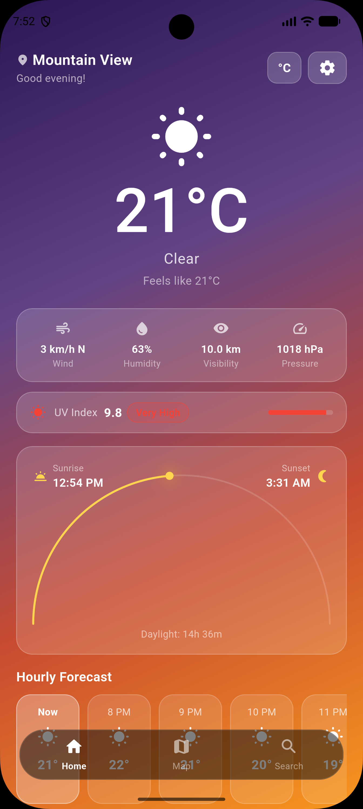
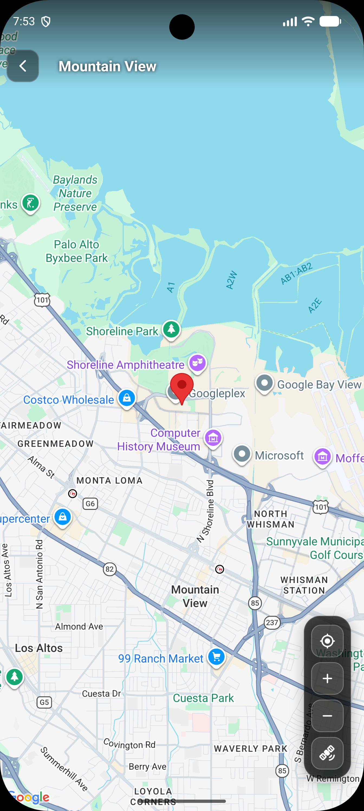
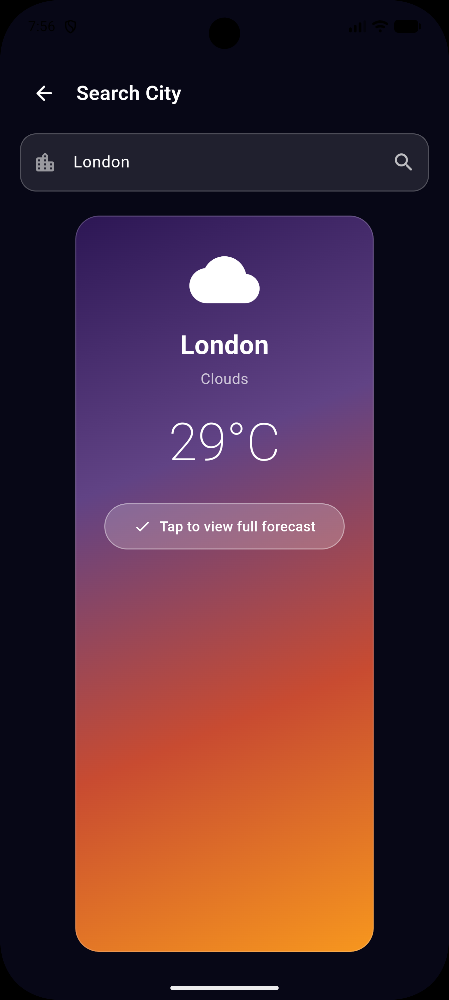

# 🌦️ WeatherSphere

**WeatherSphere** is a sleek, cross-platform weather app built with Flutter that delivers real-time weather updates, 7-day forecasts, and location-based insights in a beautifully responsive UI.

---

## ✨ Features

- 🛰️ **Real-time Weather Data**  
  Get live weather conditions including temperature, humidity, wind speed, UV index, and more.

- 📍 **Location-Based Forecast**  
  Automatically fetches weather data based on your current location using device GPS.

- 📅 **7-Day Weather Forecast**  
  Plan ahead with a detailed weekly outlook.

- 🌗 **Beautiful UI & Theme Support**  
  Light and dark themes with smooth transitions.

- 📌 **Multiple Cities Support** *(coming soon)*  
  Add and track weather in multiple locations.

---
  
## 🚀 Getting Started

### Prerequisites

Ensure you have the following installed:

- Flutter SDK (version 3.0 or higher)
- Dart
- Android Studio or Visual Studio Code
- A weather API key (e.g., OpenWeatherMap)
